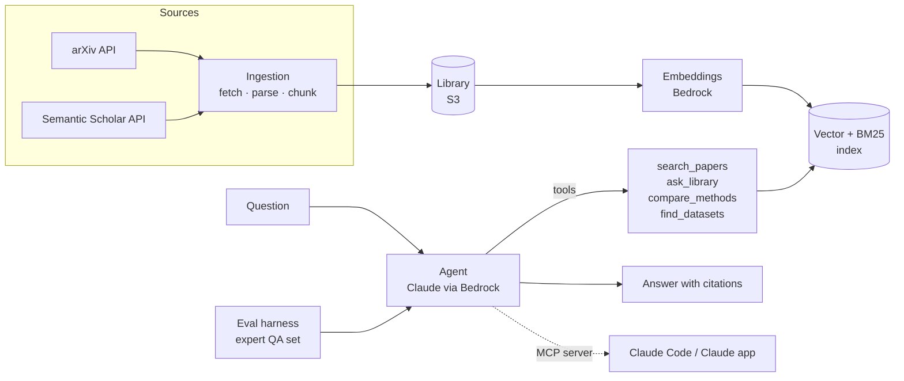

[](https://github.com/gf-gonzalez/ml-research-agent/actions/workflows/ci.yml)

# ML Research Agent

A retrieval-augmented research agent for **machine learning for science** literature
(generative models for crystals, molecules, proteins and peptides). It finds, reads and
compares papers, answers questions with section-level citations, and is **evaluated on an
expert-annotated question set** so every design choice is backed by numbers.

> **Status: in progress (started October 2026).** Week 1 of a 4-week build.
> See the [roadmap](#roadmap) for what works today.

## Why this project

General research assistants answer ML questions fluently but rarely tell you how often they
are *right*. In ML-for-science, a wrong dataset name, metric or baseline costs hours.
This project has two goals:

1. **A tool I use daily** for literature review in ML for science.
2. **A measured system**: an evaluation set written by a domain expert, with retrieval
   recall, citation faithfulness and answer correctness reported for every change.

## Architecture (target)



Deployed as a Docker container on AWS (ECS Fargate or Lambda), with an EventBridge
schedule for a weekly digest of new papers, logs and per-query cost in CloudWatch,
and CI/CD through GitHub Actions.

## Roadmap

| Week | Milestone | Status |
|------|-----------|--------|
| 1 | arXiv + Semantic Scholar ingestion, local library | ✅ fetcher, library, CLI, tests, CI |
| 1 | Chunking, hybrid retrieval (BM25 + embeddings), cited answers with Claude | 🔜 |
| 2 | Expert-annotated eval set (50–100 questions), retrieval and answer metrics, ablations | ⏳ |
| 3 | Agent tools, MCP server, FastAPI service, Docker | ⏳ |
| 4 | AWS: Bedrock, S3, ECS/Lambda, EventBridge digest, CloudWatch, CD | ⏳ |

Details in [docs/SPEC.md](docs/SPEC.md).

## Quickstart

```bash
python -m venv .venv && source .venv/bin/activate
pip install -e ".[dev]"

# Fetch the 20 newest papers on a topic into data/library.jsonl
research-agent fetch 'all:"crystal structure prediction"' --max 20 --enrich

# List the library
research-agent list
```

Optional: set `SEMANTIC_SCHOLAR_API_KEY` for higher Semantic Scholar rate limits. Both APIs can be slow or rate-limited, so requests use a 90 s timeout and retry with exponential backoff.

## Development

```bash
ruff check . && ruff format --check .
pytest
```

Tests run offline against recorded API responses. CI runs lint and tests on every push.

This project is built with [Claude Code](https://claude.com/claude-code) using
spec-driven development: intent, constraints and acceptance criteria are written in
[docs/SPEC.md](docs/SPEC.md) and [CLAUDE.md](CLAUDE.md) before code.

## Author

Gabriel F. González Estrada — MSc Biomedical Engineering, Universidad de los Andes.
Research on ML benchmarks and generative models for science (NeurIPS 2025, NeurIPS 2026,
Scientific Data).

## License

MIT
